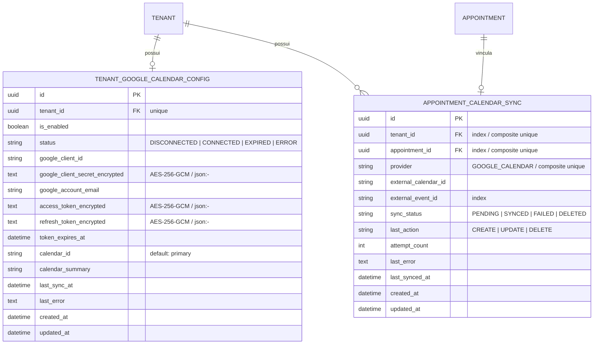
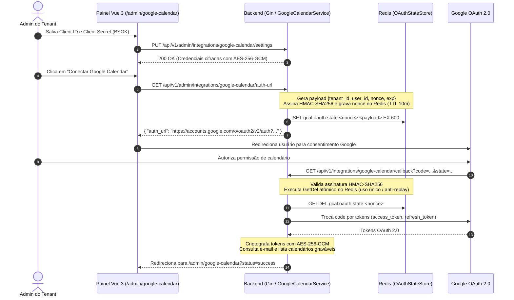
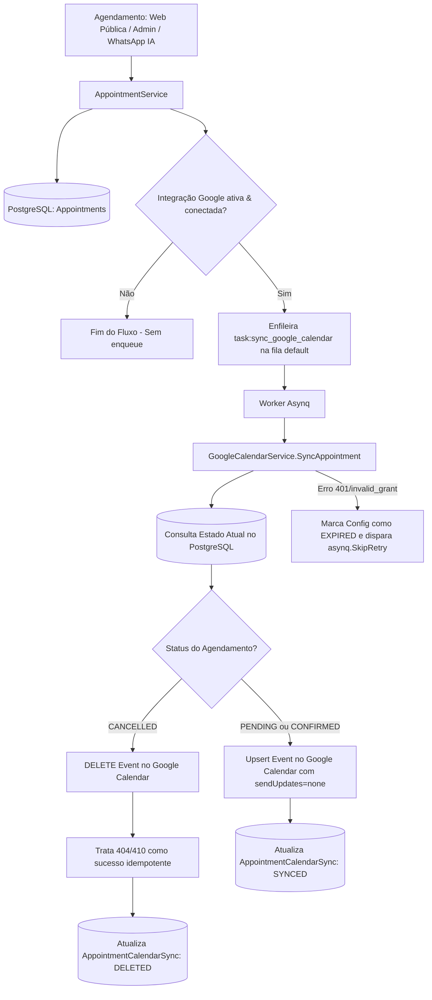

# 📅 Módulo de Integração Google Calendar (OAuth 2.0 Multi-Tenant BYOK)

Este documento descreve a arquitetura, modelo de dados, camada de segurança e criptografia, fluxo assíncrono via Asynq, catálogo de endpoints REST e interface administrativa da integração opcional e multi-tenant com o **Google Calendar (Google Agenda)** utilizando a filosofia **BYOK (*Bring Your Own Key*)**.

---

## 1. 📌 Visão Geral do Módulo

O módulo permite que cada estabelecimento comercial (`Tenant`) conecte sua própria agenda Google Calendar para sincronizar agendamentos de forma unidirecional (Agende Fácil → Google Calendar) e assíncrona via fila Asynq.

### Principais Pilares Arquiteturais:
1. **Filosofia BYOK (*Bring Your Own Key*):** A plataforma não utiliza uma conta centralizada ou Service Account compartilhada. Cada estabelecimento configura seu próprio `Client ID` e `Client Secret` obtidos no seu Google Cloud Console, garantindo isolamento total de cotas de API, limites de requisições e soberania de dados.
2. **Criptografia em Repouso (AES-256-GCM):** O `Client Secret`, `Access Token` e `Refresh Token` são gravados no banco de dados PostgreSQL cifrados com chave simétrica de 32 bytes (`ENCRYPTION_KEY`), vetor de inicialização (nonce) de 12 bytes gerado via `crypto/rand`, e marcados com `json:"-"` nos modelos para evitar vazamento em payloads de API ou logs.
3. **Segurança OAuth 2.0 com Anti-Tamper & Anti-Replay:**
   - O parâmetro `state` é assinado criptograficamente via **HMAC-SHA256** utilizando `JWT_SECRET`.
   - Um nonce aleatório é armazenado de forma atômica no Redis com TTL de 10 minutos e consumido exclusivamente via `GetDel` (uso único), inviabilizando ataques CSRF e replay.
   - Operação **fail-closed**: caso o Redis ou `OAuthStateStore` esteja inacessível, o fluxo OAuth é bloqueado preventivamente.
4. **Centralização e Unificação de Agendamentos:**
   - Todas as criações, reagendamentos e cancelamentos originados pela Web Pública (`/agendamento/:slug`), Painel Administrativo (`/admin/appointments`) e Atendimento IA via WhatsApp (`AIChatService`) convergem no `AppointmentService`.
   - O `AppointmentService` verifica preventivamente se a integração do tenant está ativa e conectada antes de enfileirar tarefas assíncronas no Asynq, garantindo higiene de fila.
5. **Reconciliação Idempotente pelo Estado Real no Banco:**
   - A tarefa assíncrona (`task:sync_google_calendar`) avalia o estado atual do agendamento persistido no PostgreSQL. Se `apt.Status == StatusCancelled`, efetua `DELETE` idempotente no Google Calendar (tratando `404 Not Found` e `410 Gone` como sucesso).
   - Para agendamentos confirmados ou pendentes, realiza `Upsert` idempotente via `UpdateEvent` ou `CreateEvent` utilizando `sendUpdates=none` para não disparar notificações abusivas.
   - Caso a autorização seja revogada ou expire (`invalid_grant`), o worker marca a conexão como `EXPIRED`, aborta retentativas desnecessárias com `asynq.SkipRetry` e expõe o erro no painel para re-autenticação.
6. **Interface Vue 3 (`GoogleCalendarView.vue`):**
   - Rota `/admin/google-calendar` com painel completo: inserção de credenciais BYOK, cópia facilitada da Redirect URI autorizada, geração de link de consentimento Google, seleção de calendário gravável (com fallback automático), status de conexão e painel de histórico/retry manual de falhas.

---

## 2. 🗄️ Modelo de Dados (GORM / PostgreSQL)

---

## 3. 🔐 Arquitetura de Segurança, OAuth 2.0 & Criptografia

---

## 4. ⚡ Fluxo de Sincronização Assíncrona & Reconciliação (Asynq)

---

## 5. 🔄 Tarefas Assíncronas (Asynq + Redis)

| Tipo de Tarefa | Fila | Payload | Comportamento |
|---|---|---|---|
| `task:sync_google_calendar` | `default` | `{"tenant_id": "uuid", "appointment_id": "uuid", "action": "CREATE\|UPDATE\|DELETE"}` | Sincroniza criação, reagendamento e cancelamento de eventos no Google Calendar do tenant de forma idempotente e não-bloqueante |

---

## 6. 🚀 Catálogo de Endpoints REST do Módulo

### 6.1 Callback Público
- `GET /api/v1/integrations/google-calendar/callback`
  - **Descrição:** Recebe redirecionamento da Google após o consentimento do usuário.
  - **Parâmetros Query:** `code`, `state` (e `error` em caso de recusa).
  - **Comportamento:** Valida a assinatura HMAC-SHA256, executa `GetDel` no Redis, troca o `code` pelos tokens OAuth, cifra com AES-256-GCM, obtém o e-mail da conta Google conectada e redireciona o navegador para `${FRONTEND_URL}/admin/google-calendar?status=success`.

### 6.2 Gestão da Integração (`ADMIN_TENANT` & `ADMIN_GLOBAL`)
*Protegidos por autenticação JWT e Gatekeeper de assinatura (`RequireActiveSubscription`).*

- `GET /api/v1/admin/integrations/google-calendar/status`
  - Retorna o status da conexão (`DISCONNECTED`, `CONNECTED`, `EXPIRED`, `ERROR`), `google_client_id`, flags booleanas (`has_client_secret`, `has_credentials`, `is_enabled`), e-mail da conta conectada, ID e nome do calendário ativo, Redirect URI e contador de falhas pendentes.
- `GET /api/v1/admin/integrations/google-calendar/auth-url`
  - Gera a URL de consentimento OAuth 2.0 personalizada com o `state` anti-CSRF e anti-replay.
- `GET /api/v1/admin/integrations/google-calendar/calendars`
  - Lista os calendários graváveis (`owner` ou `writer`) da conta Google conectada para seleção pelo tenant.
- `PUT /api/v1/admin/integrations/google-calendar/settings`
  - Permite configurar/atualizar `google_client_id`, `google_client_secret`, `calendar_id`, `calendar_summary` e habilitar/desabilitar a sincronização (`is_enabled`).
- `POST /api/v1/admin/integrations/google-calendar/disconnect`
  - Desconecta a conta Google (revoga o token na API do Google e limpa tokens/e-mail no banco), preservando as credenciais BYOK para facilitar reconexão futura.
- `GET /api/v1/admin/integrations/google-calendar/failures`
  - Retorna o histórico de agendamentos que falharam na sincronização com detalhes de erro e número de tentativas.
- `POST /api/v1/admin/integrations/google-calendar/syncs/:appointment_id/retry`
  - Reenfileira manualmente a sincronização de um agendamento específico no Asynq.

---

## 7. 💻 Interface Administrativa no Frontend (Vue 3)

A interface em `frontend/src/views/admin/GoogleCalendarView.vue` (rota `/admin/google-calendar`) foi desenhada com Tailwind CSS e Lucide Icons, oferecendo:
1. **Painel de Credenciais BYOK:** Campos para inserção de `Client ID` e `Client Secret`, botão para visualização de senha e botão para copiar com um clique a `Redirect URI` autorizada para inclusão no Google Cloud Console.
2. **Controle de Sessão & Conexão:** Botão de login OAuth ("Conectar com Google"), indicador visual de status (Conectado, Desconectado, Expirado ou Erro) e opção de desconectar.
3. **Seleção de Calendário:** Dropdown que carrega via API os calendários disponíveis na conta do usuário, com opção de fallback e preservação do calendário primário (`primary`).
4. **Histórico de Falhas & Ação de Retry:** Tabela dinâmica listando falhas recentes de sincronização com mensagem detalhada de erro, data/hora da tentativa e botão para retry instantâneo.

---

## 8. ⚙️ Variáveis de Ambiente e Configurações

| Variável | Padrão | Descrição |
|---|---|---|
| `APP_PUBLIC_URL` | `http://localhost:8080` | URL pública base da API backend para montagem de callbacks |
| `FRONTEND_URL` | `http://localhost:5173` | URL pública do frontend Vue 3 para onde o callback redireciona |
| `GOOGLE_OAUTH_REDIRECT_URI` | `${APP_PUBLIC_URL}/api/v1/integrations/google-calendar/callback` | Redirect URI padrão registrada na Google Cloud Console |
| `ENCRYPTION_KEY` | *(32 bytes hex)* | Chave mestra AES-256-GCM para cifrar secrets e tokens em repouso |
| `JWT_SECRET` | *(string secreta)* | Chave utilizada para assinar o parâmetro `state` via HMAC-SHA256 |
